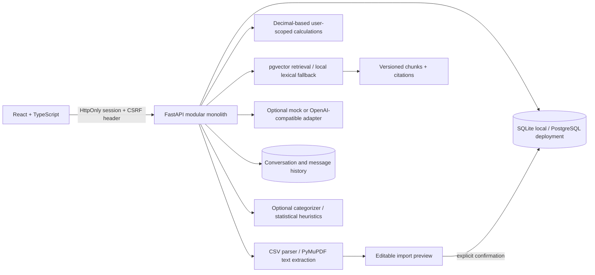

# FinSight AI

**Understand your money. Make informed decisions.**

FinSight AI is a personal-finance intelligence MVP for people who want to understand their recorded spending without giving a product their bank login. It combines a review-first statement import, deterministic transaction analytics, simple planning tools, transparent heuristics, and a small locally retrieved financial-education library.

> This is a portfolio project, not a bank, registered adviser, or certified banking system. It provides informational analysis only—not individualized investment, lending, tax, legal, or regulated financial advice.

## What works

- React/TypeScript responsive web application: landing page, registration/login, dashboard, transaction list and manual entry, statement upload/review, budgets, savings goals, recurring candidates, insights, assistant, education notes, privacy/settings.
- FastAPI API with Argon2 password hashes, rotated opaque HttpOnly sessions, CSRF checks, database-backed shared auth throttling, CSP/HSTS-capable security headers, CORS allow-list, and user-scoped data queries.
- CSV parsing and a timeout/page/size-bounded PDF adapter pipeline. Transactions are previewed and editable before confirmation. Upload bytes and PDF passwords are not retained; parsed preview rows expire after 24 hours and are erased on confirmation.
- Decimal-backed INR calculations, per-user duplicate fingerprints, CSV/data export, and transaction/account deletion.
- Persistent assistant conversations with separate calculation and citation payloads. Personal-finance Q&A uses bounded calculations over the current user's data; it does not generate SQL.
- Versioned educational documents/chunks, embeddings, pgvector top-k retrieval, relevance filtering, citation deduplication, and a deterministic SQLite fallback. Unknown topics abstain.
- A provider interface with a no-network mock default and optional environment-configured OpenAI-compatible model/embedding adapter. Rewrites with changed numeric values or URLs are rejected; token usage is recorded without storing prompts or responses.
- Optional TF-IDF + Logistic Regression categorizer, rule-based fallback, explainable median-based unusual-transaction candidates, and a three-month spending baseline.
- SQLite for quick local development, PostgreSQL + pgvector via Docker Compose, and explicit Alembic migrations.
- Fixed-seed fictional datasets and scripts for categorizer, anomaly, forecast, and retrieval evaluation.

## Honest MVP limitations

- Generic PDF extraction is best-effort and is **not universal bank support**. Scanned PDFs are detected but OCR is unavailable; balance reconciliation is attempted only when opening/closing balances can be found. Check and correct every extracted row.
- Live bank, UPI, PhonePe, Paytm, Google Pay, NPCI and Account Aggregator connectivity is not implemented. The product never requests bank passwords, OTPs, or UPI PINs.
- The LLM is disabled by default. Enabling the optional remote provider sends the verified answer text to that provider for phrasing; never enable it without reviewing provider data terms. There is no streaming or live financial-data integration.
- Education notes are FinSight-authored summaries, not imported regulatory source documents. RBI is linked as further reading; the notes do not claim RBI authorship or endorsement.
- The optional categorizer is trained on synthetic examples and is not enabled unless an artifact is generated. It is not evidence of real-world accuracy.
- Anomaly candidates and recurring-payment guesses are heuristics; neither establishes fraud or a real subscription. Forecasting requires three complete recorded months and is a simple baseline.
- Records and display are INR only. Timezone preference is configurable; currency conversion is not performed.
- No formal security certification, external penetration test, or production deployment is claimed. See the focused automated checks and remaining limitations in the security/deployment docs.

## Architecture and data flow



Personal transaction questions use constrained server-side operations. Educational questions retrieve document chunks and cite the retrieved internal document; unsupported questions return an insufficient-evidence response. Uploaded statements are untrusted input and are never used as assistant instructions.

## Technology

- Frontend: React 19, TypeScript strict, Vite, Tailwind CSS 4, React Router, TanStack Query, React Hook Form/Zod, Recharts, Lucide, Sonner.
- Backend: Python 3.13+, FastAPI, Pydantic 2, SQLAlchemy 2, Alembic, Argon2id, PyMuPDF, scikit-learn, pgvector.
- Data: SQLite for local quick-start; PostgreSQL 16 + pgvector in Compose.

## Quick start — Windows PowerShell

Prerequisites: Python 3.13, Node.js 22, and (optional) Docker Desktop. Open three PowerShell terminals at the repository root.

### 1. Generate fictional sample data

```powershell
python scripts/generate_synthetic_data.py
```

### 2. Start the API

```powershell
py -3.13 -m venv .venv
.\.venv\Scripts\Activate.ps1
python -m pip install -r backend\requirements.txt -r backend\requirements-dev.txt
Set-Location backend
alembic upgrade head
python -m uvicorn app.main:app --reload
```

The default local database is `backend\finsight.db` (SQLite). Interactive API documentation is at <http://localhost:8000/docs>; `GET /health` and `GET /ready` report process and database status.

### 3. Start the web app

```powershell
Set-Location frontend
Copy-Item .env.example .env
npm ci
npm run dev
```

Open <http://localhost:5173>, create an account, then add a transaction or import a statement. For an immediately populated local account, seed fictional records as described below. The frontend calls the API at `VITE_API_URL` (default `http://localhost:8000`).

### Seed demo transactions (optional)

From the repository root, first set a disposable local demo identity, then run the script from `backend` so its default SQLite path matches the API's default:

```powershell
$env:DEMO_EMAIL = "demo@example.test"
$env:DEMO_PASSWORD = "local-demo-password-123"
Set-Location backend
python ..\scripts\seed_demo_data.py
```

Sign in using the values set in this shell. These are synthetic local records; do not use this account or password in a public deployment.

## Docker Compose

From the repository root:

```powershell
Copy-Item .env.example .env
docker compose up --build
```

Open <http://localhost:5173>. Compose starts PostgreSQL, applies Alembic migrations before the API, and runs Vite. The default database password is only for local development. Replace it and configure HTTPS, secure cookies, CORS, and secret management before any non-local use.

Stop with `Ctrl+C`; keep the database volume by running `docker compose down`. To destroy the local database volume and all its data, explicitly run `docker compose down -v`.

## Import behavior

1. Upload a PDF or CSV (2 MB maximum).
2. The API validates content and extracts candidate rows in memory.
3. The preview shows extraction warnings and allows corrections to date, description, direction, and amount.
4. Nothing is written to the transaction table until the user confirms.
5. Confirmation uses a database transaction, skips known duplicates, and discards the preview rows.

PDF passwords are accepted only for that request and never stored. The parser supports selectable text, not OCR. Unreadable, scanned, password-locked-without-password, or unsupported files return an actionable error rather than a successful empty import. PDF bank formats vary; verify every field and reconcile statements yourself.

## Synthetic data and evaluation

All generated data is fictional and fixed-seed (`706`):

```powershell
python scripts/generate_synthetic_data.py
python scripts/evaluate_categorizer.py
python scripts/train_categorizer.py --save-artifact
python scripts/evaluate_forecaster.py
python scripts/evaluate_anomaly.py
python scripts/evaluate_rag.py
```

`scripts/evaluate_categorizer.py` writes the versioned per-class report used by the app's evaluation page and ignored `artifacts\` output; an optional model artifact is written under ignored `backend\app\ml\artifacts\`. The application uses deterministic rules if no artifact exists. Synthetic classification scores do not measure real-world performance. `scripts\ingest_knowledge_base.py` refreshes the bundled notes or ingests a metadata manifest of local/HTTPS HTML, PDF, and text sources.

## Tests and checks

```powershell
python scripts/run_checks.py
```

This runs backend Ruff/mypy checks and tests, ZIP-packager tests, frontend tests, and the TypeScript/production build. CI also applies migrations and tests against PostgreSQL + pgvector, audits Python and npm dependencies, and evaluates the synthetic baselines. You can run the pieces individually:

```powershell
Set-Location backend
python -m pytest -q
Set-Location ..\frontend
npm run typecheck
npm run build
```

Checks include Ruff, a focused mypy pass for the LLM adapter interface, registration/login/session rotation, CSRF/security headers, cross-user access, transaction calculations, CSV/PDF review and confirm behavior, duplicate handling, persistent conversations, assistant grounding/abstention, data deletion, settings/export, budgets and goals. CI applies Alembic migrations and runs backend tests against PostgreSQL with pgvector.

## Source ZIP

Create a validated source archive (without Git history, dependencies, build output, local environment files, databases, or local model artifacts):

```powershell
python scripts/package_project.py
```

The default output is `artifacts\finsight-ai-mvp.zip`. Use `--output C:\path\to\archive.zip` to choose another destination. The packager verifies ZIP integrity and required project files before reporting success.

## Configuration

See [`.env.example`](./.env.example), [`backend/.env.example`](./backend/.env.example), and [`frontend/.env.example`](./frontend/.env.example).

| Variable | Purpose |
|---|---|
| `DATABASE_URL` | SQLAlchemy URL; local default is SQLite; Compose uses PostgreSQL/psycopg |
| `AUTO_CREATE_SCHEMA` | Local convenience only; set `false` when using migrations in deployment |
| `COOKIE_SECURE` | Set `true` behind HTTPS in production |
| `CORS_ORIGINS` | Comma-separated explicit browser origins |
| `LLM_PROVIDER` | `mock` (default) or `openai` |
| `OPENAI_API_KEY` | Required only for the optional OpenAI-compatible provider |
| `OPENAI_MODEL`, `OPENAI_EMBEDDING_MODEL` | Optional provider model overrides |
| `LLM_TIMEOUT_SECONDS` | Provider request timeout (default 10 seconds; three bounded attempts) |
| `VITE_API_URL` | API origin compiled into the frontend |
| `CATEGORIZER_MODEL_PATH` | Optional local versioned sklearn artifact path |
| `DEMO_EMAIL`, `DEMO_PASSWORD` | Required only for local synthetic-data seeding |

No LLM credentials, bank credentials, or paid service are required for the local demo. The mock provider and SQLite lexical fallback are used by default.

## API and data

The backend OpenAPI spec is generated at `/openapi.json`. See [API reference](docs/api-reference.md) and [schema notes](docs/database-schema.md). Financial amounts use decimal/fixed precision. Transactions, import jobs, budgets, goals, recurring statuses, settings, and sessions are owned by a user ID; resource lookups include that owner in the query.

## Security, retention, and deployment

See [security and privacy](docs/security-and-privacy.md), [deployment](docs/deployment.md), [limitations](docs/project-limitations.md), and the [knowledge retrieval pipeline](docs/rag-pipeline.md). Database-backed auth throttling is not a substitute for edge-level abuse protection. Backups are controlled by the database operator; deleting application data cannot retract data already present in operator-managed backups. Do not use real account statements until you have reviewed the code and deployment controls.

No live deployment has been performed or verified.
