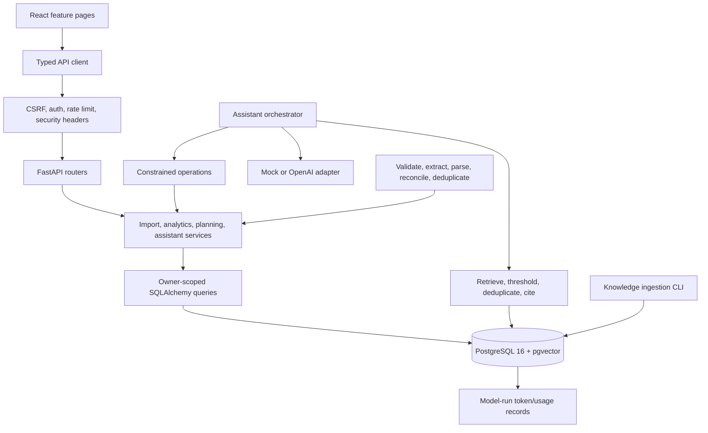

# Architecture

FinSight is a modular monolith: a React/TypeScript web application talks to one FastAPI API, and SQLAlchemy repositories/services use a single SQLite or PostgreSQL database. The API owns all authoritative money calculations. PostgreSQL 16 with pgvector is the deployment target; SQLite remains useful for local development and tests.

## Answering paths

The assistant separates personal-data questions from financial-education questions. Personal questions are classified into fixed operations over the authenticated user's rows; generated SQL is never accepted or executed. The returned calculation card, values, dates, and citations remain server-authored. The optional LLM adapter receives only the already-verified response for constrained phrasing; a rewrite is rejected if its numeric values or URLs differ from the source. The mock provider is the default and makes no network requests. The OpenAI-compatible adapter is enabled only with `LLM_PROVIDER=openai` and `OPENAI_API_KEY`, and uses bounded timeouts/retries.

Education answers retrieve versioned document chunks. PostgreSQL stores 1536-dimension embeddings and performs cosine-distance top-k retrieval with a relevance cutoff and per-document deduplication. SQLite and no-credential local flows use a deterministic lexical fallback. Citations link to an internal document record and identify the verified publisher/reference URL; unknown questions abstain. The bundled notes are FinSight-authored summaries, not claims of RBI authorship. The RBI Financial Education page was verified at <https://www.rbi.org.in/FinancialEducation/Home.aspx> on 2026-10-15.

## Import and persistence boundaries

Statement imports follow `uploaded → parsed → preview → confirmed` (or `expired`/`failed`) semantics. Upload bytes and PDF passwords are never stored. Parsing is size/page/time bounded. The generic bank adapter extracts text, flags scanned PDFs, attempts opening/closing balance reconciliation when both balances are present, and requires review. Confirmation writes transactions in one database transaction; `(user_id, fingerprint)` uniqueness makes duplicates idempotent. Preview data expires after 24 hours and is erased after confirmation.

Every owner-scoped query takes an authenticated `user_id`. Foreign resource IDs resolve to 404. User deletion removes conversations/messages and user-owned records; model usage records are retained without the user ID. Monetary values use `Decimal` and `Numeric(14,2)` at rest.

## Persistence and deployment

Alembic migrations are explicit, versioned schema changes; deploy with `AUTO_CREATE_SCHEMA=false` and run migrations as a release step. The migration set enables pgvector on PostgreSQL and creates relational constraints/indexes plus an HNSW cosine index. `/ready` checks database access. The authentication-attempt limiter uses Postgres/SQLite upserts, so it is shared between API workers using the same database. TLS termination, secure cookies, secrets, backup retention, and operational monitoring remain deployment responsibilities.

There is no Redis, background worker, OCR service, or live bank integration. A disabled financial-data provider extension point does not enable bank connectivity; settings explicitly report that live connections are unavailable.
