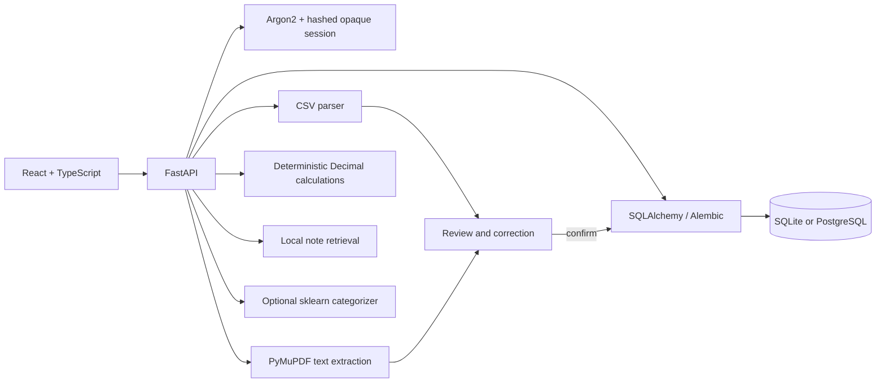

# Architecture

FinSight is a modular monolith. The React application calls a FastAPI REST API; SQLAlchemy scopes each user-owned transaction, import, budget, goal, recurring status, and setting query by authenticated user ID. SQLite is the quick-start database and PostgreSQL is the Compose/deployment target.

The import pipeline does not persist raw statement bytes. Parsed candidates are stored temporarily in an owner-scoped import job for correction, expire after 24 hours, and are erased after confirmation. Personal queries use fixed operations and do not issue generated SQL. Retrieved education notes are static, authored by this project, and are never treated as instructions.

## Deliberate boundaries

- No financial provider connector is enabled.
- The education retriever is lexical term-overlap over a small local corpus, not an embedding model or pgvector service.
- LLM providers, streaming responses, persistent chat history, OCR, background workers, and distributed rate limiting are not present.
- Compose includes PostgreSQL with pgvector available, but this version does not create vector columns or run vector queries.
